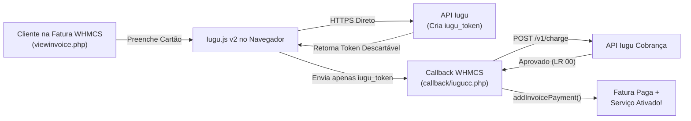

# WHMCS Iugu Credit Card Checkout Gateway (`iugucc`)

[](./VERSION)
[](https://www.whmcs.com/)
[](https://www.php.net/)
[](https://dev.iugu.com/)

> **Português (BR)** | [English Below](#-english-documentation)

---

## 🇧🇷 Documentação em Português

Módulo comercial de gateway de pagamento via **Cartão de Crédito (Checkout Transparente)** para **WHMCS 8.13.7** (PHP 8.1 e 8.2), integrado à API REST v1 da **Iugu** e tokenização client-side via **Iugu.js v2**, desenvolvido para **imovelsite.com.br** (`https://www.webstorage.net.br/financeiro/master/`).

### Principais Recursos
- **Conformidade PCI-DSS Total (Tokenização Client-Side):** Os dados sensíveis do cartão (`número` e `CVV`) são tokenizados diretamente no navegador do cliente via `https://js.iugu.com/v2` e **jamais** passam pelo servidor do WHMCS.
- **Baixa Automática Síncrona e Assíncrona (Webhook):**
  - **Retorno Síncrono:** Assim que a cobrança (`POST /v1/charge`) retorna `LR 00`, o módulo registra o pagamento imediatamente via `addInvoicePayment()`, deduzindo a taxa real da Iugu (`taxes_paid_cents`) e acionando a liberação/provisionamento automático do serviço contratado no WHMCS.
  - **Webhook Idempotente:** O endpoint `modules/gateways/callback/iugucc.php` recebe notificações `invoice.status_changed` da Iugu, confirma a autenticidade diretamente na API (`GET /v1/invoices/{id}`) e garante que nenhuma fatura receba baixa duplicada.
- **Zero Interferência com o Módulo de Boleto Existente:** Utiliza o identificador exclusivo `iugucc`, convivendo em total harmonia com o módulo de boleto bancário da Iugu já instalado (por Edvan).
- **Suporte a Parcelamento e Estornos:** Configurável de `1x` a `12x` com valor mínimo de parcela e suporte nativo a reembolso total ou parcial (`iugucc_refund`) direto pelo painel Admin do WHMCS.

---

### Prévia da Interface de Checkout Transparente (`viewinvoice.php`)

```text
+-----------------------------------------------------------------------+
|  Pagamento com Cartão de Crédito                             [ VISA ] |
|  Ambiente seguro criptografado via Iugu (PCI-DSS)                     |
|-----------------------------------------------------------------------|
|  [!] MODO SANDBOX / TESTE ATIVO (Exibido apenas em modo de teste)     |
|                                                                       |
|  Número do Cartão                                                     |
|  [ 4111 1111 1111 1111                                             ]  |
|                                                                       |
|  Nome Impresso no Cartão                                              |
|  [ JOAO SILVA                                                      ]  |
|                                                                       |
|  Validade (MM/AA)                 Código de Segurança (CVV)           |
|  [ 12/30                       ]  [ ***                            ]  |
|                                                                       |
|  CPF ou CNPJ do Titular                                               |
|  [ 123.456.789-09                                                  ]  |
|                                                                       |
|  Parcelamento                                                         |
|  [ 3x de R$ 50,00 sem juros                                    (v) ]  |
|                                                                       |
|  [               Pagar Agora com Cartão (R$ 150,00)                ]  |
|-----------------------------------------------------------------------|
|  🔒 Seus dados de cartão são tokenizados diretamente no navegador     |
|     e nunca ficam armazenados em nosso servidor.                      |
+-----------------------------------------------------------------------+
```

---

### Fluxo de Arquitetura e Pagamento



---

### Estrutura de Diretórios
```text
.
├── AGENTS.md                           # Regras obrigatórias de segurança e backup em archived/
├── CHANGELOG.md                        # Histórico de versões (SemVer)
├── VERSION                             # Versão atual do módulo (1.1.0)
├── composer.json                       # Metadados do pacote e scripts
├── archived/                           # Diretório local de backups (ignorado no .gitignore)
├── docs/
│   ├── ARCHITECTURE.md                 # Diagramas de sequência e arquitetura PCI-DSS
│   ├── INSTALLATION_WHMCS.md           # Passo a passo de instalação no WHMCS 8.13.7 e Iugu
│   └── SANDBOX_TESTING.md              # Guia de testes Sandbox e códigos LR
├── modules/
│   └── gateways/
│       ├── iugucc.php                  # Entry point principal do módulo WHMCS
│       ├── callback/
│       │   └── iugucc.php              # Handler síncrono de checkout + Webhook assíncrono
│       └── iugucc/
│           ├── autoload.php            # Autoloader PSR-4 standalone (sem necessidade de SSH/Composer)
│           ├── assets/                 # CSS e JS (integração Iugu.js v2)
│           ├── lang/                   # Traduções PT-BR e EN
│           ├── lib/                    # Cliente HTTP Iugu, sanitizador PCI e processadores
│           └── templates/              # Template HTML seguro do checkout
├── scripts/
│   ├── bump-version.js                 # Utilitário de bump semântico de versão
│   ├── cloud-env-setup.sh              # Setup do ambiente de nuvem (PHP 8.1 + 8.2, lint, Sentinel)
│   ├── sentinel-autosetup.php          # Agente Sentinela & AutoSetup (PHP)
│   └── sentinel-autosetup.js           # Agente Sentinela & AutoSetup (Node)
└── tests/
    ├── run_tests.js                    # Suíte automatizada de testes (48 asserções + E2E Sandbox)
    ├── adversarial_suite.js            # Testes adversariais de payload e PCI (Node)
    ├── adversarial_webhook_test.js     # Testes adversariais de idempotência de Webhook (Node)
    ├── adversarial_stress_test.php     # Testes adversariais de stress (PHP 8.1/8.2)
    ├── phpunit_runner.php              # Runner nativo para PHP 8.1/8.2 CLI
    └── fixtures/                       # Payloads de simulação da API Iugu
```

---

### Ambiente de Nuvem para Revisão e Testes (Claude Code)
O repositório possui um ambiente de nuvem dedicado ao papel de **revisor e tester**, que garante compatibilidade com o WHMCS 8.13.7 e com a API Iugu v1 sem tocar em servidores de produção. O script `scripts/cloud-env-setup.sh` prepara o container (PHP 8.1 e 8.2 CLI com `curl`, `json`, `mbstring`, `openssl`; `archived/`; lint; Sentinel AutoSetup). Hosts de rede, variáveis e política de segredos estão documentados na seção 5 do [`AGENTS.md`](./AGENTS.md).

```bash
# Suíte completa exatamente como a CI (executar em PHP 8.1 e 8.2):
mkdir -p archived
find modules scripts tests -name "*.php" -print0 | xargs -0 -n1 php -l
php scripts/sentinel-autosetup.php && node scripts/sentinel-autosetup.js
node tests/run_tests.js && node tests/adversarial_suite.js && node tests/adversarial_webhook_test.js
php tests/phpunit_runner.php && php tests/adversarial_stress_test.php
```

---

### Instalação Rápida
1. Copie a pasta `modules/` para a raiz da instalação do WHMCS (`<whmcs_root>/modules/gateways/...`).
2. No painel Admin do WHMCS, acesse **Setup > Payments > Payment Gateways > All Payment Gateways** e ative **Iugu - Cartão de Crédito (Checkout Transparente)**.
3. Configure seu **ID da Conta Iugu (Account ID)**, **Token de API** e se desejar operar em **Modo Sandbox**.
4. No painel da Iugu (**Configurações > Gatilhos**), aponte o webhook para:
   `https://www.webstorage.net.br/financeiro/master/modules/gateways/callback/iugucc.php`

Consulte os manuais detalhados em:
- [Guia Completo de Instalação no WHMCS 8.13.7](./docs/INSTALLATION_WHMCS.md)
- [Arquitetura e Segurança PCI-DSS](./docs/ARCHITECTURE.md)
- [Guia de Testes em Modo Sandbox](./docs/SANDBOX_TESTING.md)
- [Manifesto de Mapeamento de Esquemas (WHMCS ↔ Iugu ↔ Sentinela)](./docs/SCHEMA_MAPPING.md)
- [Agente Sentinela & AutoSetup (Snapshot No-Hot, Watchdog & Prontidão Comercial)](./docs/SENTINEL_AUTOSETUP.md)

---

## 🇺🇸 English Documentation

Commercial-grade, configurable **Credit Card Transparent Checkout** payment gateway module for **WHMCS 8.13.7** (PHP 8.1 and 8.2), integrated with the **Iugu REST API v1** and **Iugu.js v2** client-side tokenization.

### Key Features
- **PCI-DSS Client-Side Tokenization:** Cardholder data (`number` and `verification_value`) are tokenized in the browser via `https://js.iugu.com/v2`. Card inputs intentionally omit HTML `name` attributes so raw card numbers never touch the WHMCS server.
- **Synchronous Checkout & Idempotent Webhook Handler:**
  - Marks WHMCS invoices as `Paid` immediately upon checkout approval (`addInvoicePayment`), recording the exact Iugu gateway fee (`taxes_paid_cents`) and automatically triggering WHMCS service provisioning.
  - Includes an asynchronous webhook callback (`modules/gateways/callback/iugucc.php`) that verifies invoice status server-to-server (`GET /v1/invoices/{id}`) and updates unpaid invoices idempotently.
- **Non-Interference by Design:** Uses the dedicated `iugucc` module identifier so it never conflicts with existing Iugu Boleto modules.

### Running Automated Tests & Version Bumping
```bash
# Run the automated unit, PCI-DSS, and E2E Sandbox simulation suite:
node tests/run_tests.js

# Bump semantic version (automatically backs up modified files to archived/):
node scripts/bump-version.js patch
```

### Cloud Review & Testing Environment (Claude Code)
A dedicated cloud environment acts as **reviewer and tester**, validating compatibility with WHMCS 8.13.7 and the Iugu API v1 without touching production servers. `scripts/cloud-env-setup.sh` provisions the container (PHP 8.1 and 8.2 CLI with `curl`, `json`, `mbstring`, `openssl`; the `archived/` directory; strict lint on both versions; Sentinel AutoSetup). Allowed network hosts, non-secret variables and the secrets policy are documented in section 5 of [`AGENTS.md`](./AGENTS.md). Iugu.js v2 is loaded from its official host `https://js.iugu.com/v2`; the host `js.iugu.net` does not exist and is rejected by a regression test.
