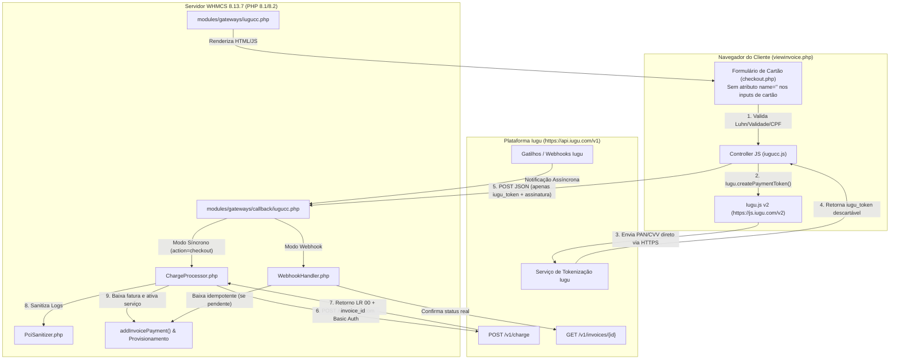
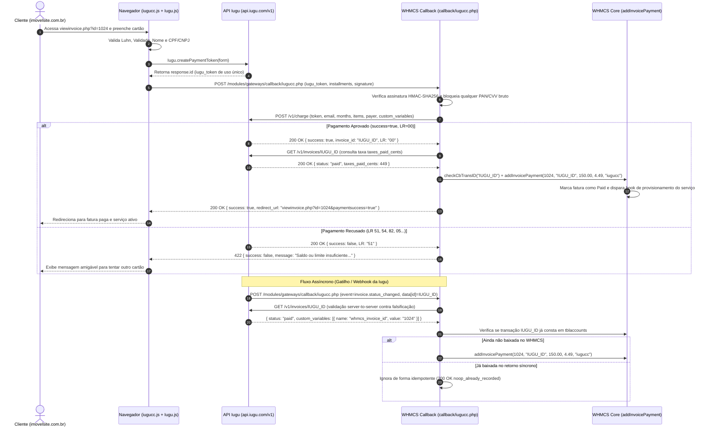

# Arquitetura Técnica — WHMCS Iugu Credit Card Gateway (`iugucc`)

Este documento descreve a arquitetura interna, o fluxo de segurança PCI-DSS e os contratos de integração entre o **WHMCS 8.13.7** (PHP 8.1/8.2), o navegador do cliente (**Iugu.js v2**) e a **API REST v1 da Iugu**.

---

## 1. Visão Geral dos Componentes

---

## 2. Fluxo de Sequência: Checkout Síncrono e Webhook Assíncrono

---

## 3. Garantias de Conformidade PCI-DSS
1. **Desativação de Armazenamento Local no WHMCS**: `iugucc_MetaData()` define `'DisableLocalCreditCardInput' => true`, garantindo que o WHMCS não armazene dados de cartão no banco de dados.
2. **Inputs HTML sem Atributo `name`**: No arquivo `modules/gateways/iugucc/templates/checkout.php`, os campos com `data-iugu="number"`, `data-iugu="verification_value"`, `data-iugu="expiration"` e `data-iugu="full_name"` não possuem atributo `name`. Assim, mesmo que o formulário sofra um submit nativo, o navegador jamais transmite esses campos ao servidor.
3. **Bloqueio Ativo e Sanitização (`PciSanitizer`)**: Caso qualquer requisição malformada tente enviar campos de cartão ao endpoint `callback/iugucc.php`, `PciSanitizer::containsRawCardData()` rejeita a requisição imediatamente com `PCI_BLOCKED` e redacta qualquer sequência numérica de 13 a 19 dígitos antes de chamar `logTransaction()`.

---

## 4. Isolamento e Não-Interferência
- O módulo utiliza o nome de sistema exclusivo `iugucc`.
- Nenhum arquivo do módulo existente de boleto bancário da Iugu (desenvolvido por Edvan) é lido, modificado ou sobrescrito.
- Na API da Iugu, cada fatura gerada pelo `iugucc` recebe `custom_variables` contendo `whmcs_invoice_id` e `integration_module = iugucc`. Caso o Webhook receba eventos de faturas externas sem vínculo com o WHMCS, o `WebhookHandler` responde `200 OK` (`ignored_foreign_invoice`) sem gerar erros.
