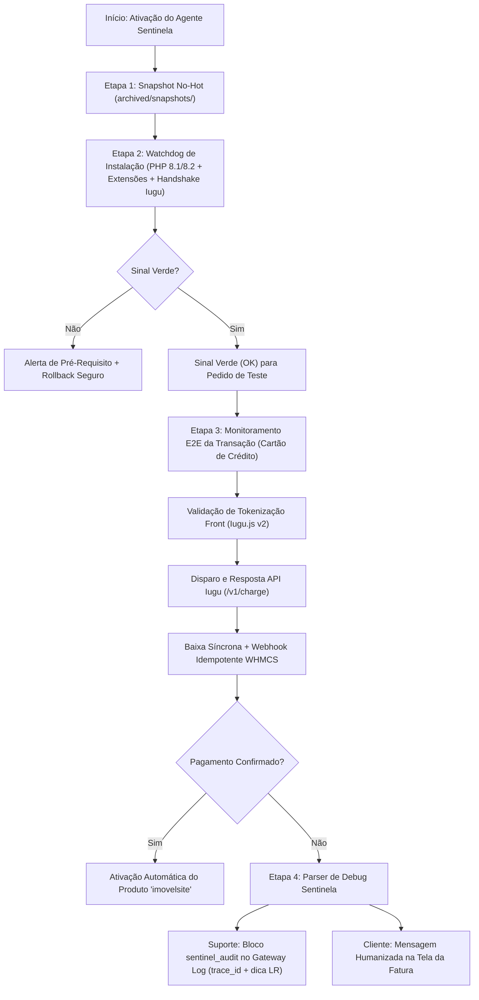

# Agente Sentinela & AutoSetup (WHMCS + Iugu CC) — Guia Técnico e Operacional

Este documento especifica a arquitetura, operação e uso do **Agente Sentinela & AutoSetup (`SentinelAuditor`)** integrado ao módulo `iugucc` (`v1.1.0`), bem como o checklist de prontidão comercial para o **WHMCS Marketplace** e o roteiro passo a passo de implantação segura em produção (`bells.webstorage.com.br`).

---

## 1. Arquitetura do Agente Sentinela

O **Agente Sentinela** foi implementado diretamente no núcleo do módulo em [`modules/gateways/iugucc/lib/SentinelAuditor.php`](../modules/gateways/iugucc/lib/SentinelAuditor.php) e exposto via utilitário de linha de comando/web em [`scripts/sentinel-autosetup.php`](../scripts/sentinel-autosetup.php), além de contar com chaveamento (Liga/Desliga) direto no painel Admin do WHMCS (`sentinelMode`).



---

## 2. Como Executar o AutoSetup & Healthcheck Pré-Instalação

Antes de ativar o módulo no WHMCS ou rodar o primeiro pedido de teste, execute:

```bash
# Verificação local de integridade + geração de Snapshot No-Hot:
php scripts/sentinel-autosetup.php

# Com teste de Handshake real na API da Iugu (sem cobrança monetária):
IUGU_ACCOUNT_ID="SEU_ACCOUNT_ID_32_HEX" IUGU_API_TOKEN="SEU_TOKEN_TESTE_OU_PROD" php scripts/sentinel-autosetup.php
```

### O que o comando executa:
1. **Snapshot Consistente ("No-Hot"):** Gera um arquivo `archived/snapshots/snapshot_<YYYYMMDD_HHMMSS>.json` contendo o hash `SHA-256`, tamanho em bytes e timestamp de todos os 16 arquivos do módulo `iugucc`, além de confirmar o isolamento do módulo de boleto existente.
2. **Watchdog de Instalação:**
   - Confirma versão do PHP (`>= 8.1.0`).
   - Verifica extensões obrigatórias (`curl`, `json`, `mbstring`, `openssl`).
   - Confirma presença e permissão de leitura de todos os arquivos do módulo.
   - Se `IUGU_ACCOUNT_ID` e `IUGU_API_TOKEN` forem informados, realiza uma chamada `GET /v1/invoices?limit=1` autenticada para atestar conectividade TLS e validade do token.
3. **Emissão do Sinal Verde:** Retorna `green_light: true` e exit code `0` quando o ambiente está 100% pronto.

---

## 3. Avaliação de Prontidão Comercial (WHMCS Marketplace Readiness)

O módulo foi auditado e adequado aos requisitos oficiais de distribuição comercial no **WHMCS Marketplace**:

| Requisito Oficial WHMCS Marketplace | Status no Módulo `iugucc` (`v1.1.0`) | Evidência / Arquivo |
| :--- | :--- | :--- |
| Manifesto `whmcs.json` (Schema 1.0) | ✅ Cumprido | [`modules/gateways/iugucc/whmcs.json`](../modules/gateways/iugucc/whmcs.json) |
| Logotipo Oficial do Módulo (SVG + PNG usado pelo Apps & Integrations) | ✅ Cumprido | [`modules/gateways/iugucc/logo.svg`](../modules/gateways/iugucc/logo.svg), [`logo.png`](../modules/gateways/iugucc/logo.png) |
| Isolamento de Namespace PSR-4 Sem Colisão | ✅ Cumprido | `WHMCS\Module\Gateway\IuguCC\*` via [`autoload.php`](../modules/gateways/iugucc/autoload.php) |
| Zero Dependência Externa de Composer no Host | ✅ Cumprido | Autoloader nativo embutido para qualquer cPanel |
| Conformidade PCI-DSS SAQ A | ✅ Cumprido | Tokenização client-side `Iugu.js v2` + [`PciSanitizer.php`](../modules/gateways/iugucc/lib/PciSanitizer.php) |
| Internacionalização (i18n PT-BR & EN) | ✅ Cumprido | [`lang/portuguese-br.php`](../modules/gateways/iugucc/lang/portuguese-br.php) e [`lang/english.php`](../modules/gateways/iugucc/lang/english.php) |
| Suporte a Reembolso Automatizado (`_refund`) | ✅ Cumprido | `iugucc_refund()` em [`modules/gateways/iugucc.php`](../modules/gateways/iugucc.php) |
| Compatibilidade Estrita PHP 8.1 / 8.2 | ✅ Cumprido | `declare(strict_types=1);` em 100% dos arquivos PHP |
